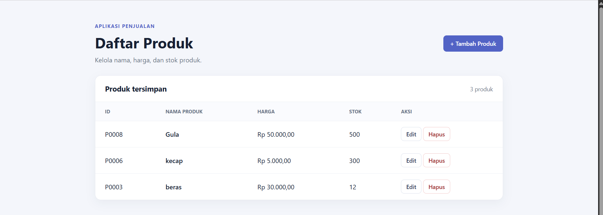

<div align="center">


<h1>✨ Arsip Praktikum PBW ✨</h1>

<p><b>Dari baris kode pertama hingga aplikasi web yang siap dijelajahi.</b></p>
<p>Dokumentasi laporan, latihan, dan proyek praktikum Pemrograman Berbasis Web.</p>

<br>


<br><br>


</div>

<br>

<table align="center">
  <tr>
    <td align="center" width="33%"><b>👨‍🎓 MAHASISWA</b><br><br>Bryan Ananda Saputra Hulu</td>
    <td align="center" width="33%"><b>🪪 NPM / NIM</b><br><br><code>4524210020</code></td>
    <td align="center" width="33%"><b>📖 MATA KULIAH</b><br><br>Praktikum Pemrograman Berbasis Web</td>
  </tr>
</table>

<br>

## 🧭 Jelajahi README

<div align="center">

[🌌 Tentang](#-tentang-repositori)　•　[🗺️ Praktikum](#️-peta-perjalanan-praktikum)　•　[💎 Proyek Pilihan](#-proyek-pilihan)　•　[🧰 Teknologi](#-teknologi--tools)　•　[🚀 Cara Menjalankan](#-menjalankan-aplikasi)

</div>

---

## 🌌 Tentang Repositori

Selamat datang di **arsip perjalanan praktikum PBW**! Repository ini menghimpun laporan dan tugas dari berbagai pertemuan, mulai dari dasar pemrograman PHP, pengolahan formulir dan database, hingga aplikasi web dengan pola **Model-View-Controller (MVC)**.

> 💡 Tujuan repo ini adalah mendokumentasikan proses belajar sekaligus menyimpan kode dan hasil praktikum dalam satu tempat.

## 🗺️ Peta Perjalanan Praktikum

| # | Petualangan | Isi folder |
|:---:|:---|:---|
| **01** | 🧮 **Memulai dengan PHP** | [Biodata, kalkulator, dan laporan](prak1/) |
| **02** | 💻 **Melatih logika program** | [Latihan PHP dan laporan pertemuan 2](prak2/) |
| **03** | 🗄️ **Membangun fondasi database** | [Desain struktur database dan perintah DDL](prak3/) |
| **04** | 🔎 **Menjelajahi data dengan SQL** | [Query dan manipulasi data DML](prak4/) |
| **05** | 📝 **Mengolah input pengguna** | [Formulir dan penyimpanan data](prak5/) |
| **06** | 📋 **Mengelola data aplikasi** | [Latihan pengelolaan data dengan PHP](prak6/) |
| **07** | 🏗️ **Merangkai aplikasi MVC** | [Aplikasi akademik dan penjualan](prak7/) |

<div align="center">

**PHP Dasar**　➜　**Database**　➜　**Aplikasi Web**　➜　**MVC**

</div>

## 💎 Proyek Pilihan

Pada pertemuan 7, latihan berkembang menjadi dua aplikasi berbasis PHP dan MySQL. Klik gambar untuk melihat folder proyeknya.

<table>
  <tr>
    <td align="center" width="50%">
      <a href="prak7/akademik-mvc/">
        
      </a>
      <br><br>
      <b>🎓 Akademik MVC</b>
      <br>
      Direktori mahasiswa dengan struktur Model-View-Controller.
      <br><br>
      <a href="prak7/akademik-mvc/">Jelajahi proyek →</a>
    </td>
    <td align="center" width="50%">
      <a href="prak7/penjualan-mvc/">
        
      </a>
      <br><br>
      <b>🛍️ Penjualan MVC</b>
      <br>
      Aplikasi untuk menampilkan dan mengelola produk.
      <br><br>
      <a href="prak7/penjualan-mvc/">Jelajahi proyek →</a>
    </td>
  </tr>
</table>

## 🧰 Teknologi & Tools

<div align="center">

#### Bahasa & teknologi


#### Tools & database


</div>

## 🚀 Menjalankan Aplikasi

> Langkah ini untuk aplikasi MVC di `prak7/`. Siapkan PHP dan MySQL lokal, lalu pastikan database sudah tersedia dan pengaturan koneksi pada `koneksi.php` sesuai dengan lingkunganmu.

Buka terminal pada folder `prak7`, kemudian jalankan server PHP:

```bash
php -S localhost:8080
```

Pilih aplikasi yang ingin dibuka:

| Aplikasi | Tautan lokal |
|:---|:---|
| 🎓 Akademik MVC | [Buka aplikasi](http://localhost:8080/akademik-mvc/) |
| 🛍️ Penjualan MVC | [Buka aplikasi](http://localhost:8080/penjualan-mvc/) |

<br>

<div align="center">


### 🌱 Terus belajar. Terus berkarya. Terus berkembang.

_Satu praktikum, satu langkah lebih dekat menjadi web developer._

</div>
