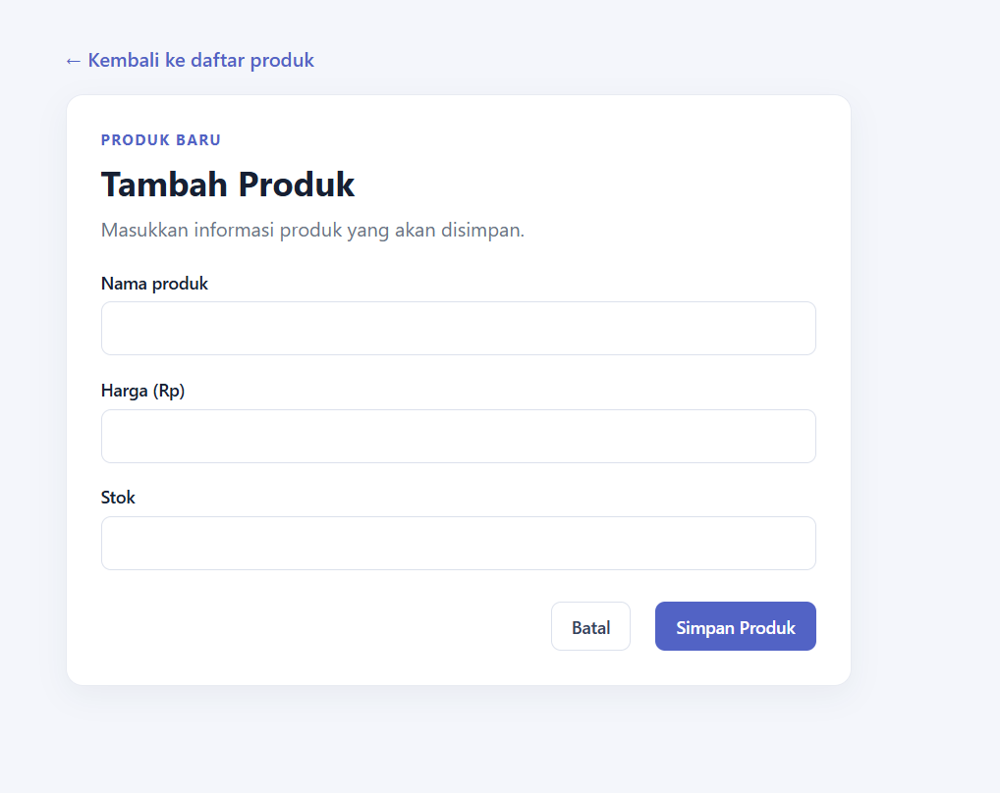
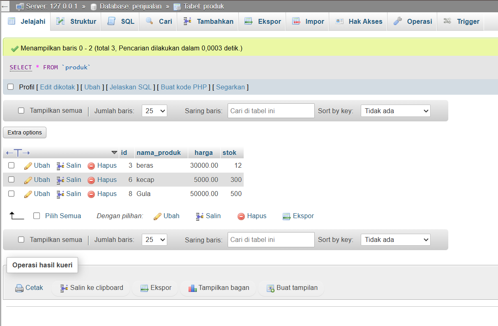

# Aplikasi Penjualan MVC

Aplikasi PHP sederhana untuk mengelola produk menggunakan pola Model-View-Controller (MVC) dan database MySQL.

## Fitur

- Menampilkan daftar produk beserta jumlah produk.
- Menambahkan produk dengan nama, harga, dan stok.
- Mengedit produk yang sudah tersimpan.
- Menghapus produk dari database setelah konfirmasi.
- Menampilkan ID produk dengan awalan `P` (contoh: `P0001`).

## Teknologi

- PHP
- MySQL
- MySQLi
- HTML dan CSS

## Struktur folder

```text
penjualan-mvc/
├── index.php
├── koneksi.php
├── controllers/
│   └── ProdukController.php
├── models/
│   └── ProdukModel.php
├── views/
│   └── produk/
│       ├── index.php
│       ├── create.php
│       └── edit.php
└── assets/
    ├── css/
    │   └── style.css
    └── img/
        ├── daftar-produk.png
        ├── input-produk.png
        └── database-penjualan.png
```

## Menyiapkan database

Buat database dan tabel berikut melalui MySQL atau phpMyAdmin:

```sql
CREATE DATABASE penjualan
    CHARACTER SET utf8mb4
    COLLATE utf8mb4_unicode_ci;

USE penjualan;

CREATE TABLE produk (
    id INT UNSIGNED NOT NULL AUTO_INCREMENT,
    nama_produk VARCHAR(150) NOT NULL,
    harga DECIMAL(12, 2) NOT NULL,
    stok INT UNSIGNED NOT NULL DEFAULT 0,
    PRIMARY KEY (id)
);
```

Konfigurasi koneksi bawaan di `koneksi.php` menggunakan host `127.0.0.1`, port `3306`, pengguna `root`, tanpa kata sandi, dan database `penjualan`. Sesuaikan variabel koneksi tersebut bila konfigurasi MySQL berbeda.

## Menjalankan aplikasi

Jalankan server PHP dari folder `prak7`:

```bash
php -S localhost:8080
```

Buka [http://localhost:8080/penjualan-mvc/](http://localhost:8080/penjualan-mvc/) di browser. Jika menggunakan Apache XAMPP, letakkan proyek di document root Apache dan buka folder `penjualan-mvc` melalui alamat lokal.

## Screenshot

### Halaman daftar produk


### Form tambah produk



### Tabel produk di phpMyAdmin


